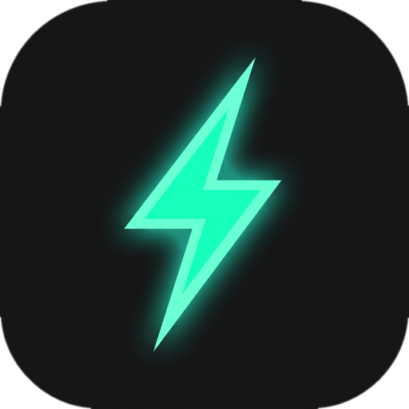
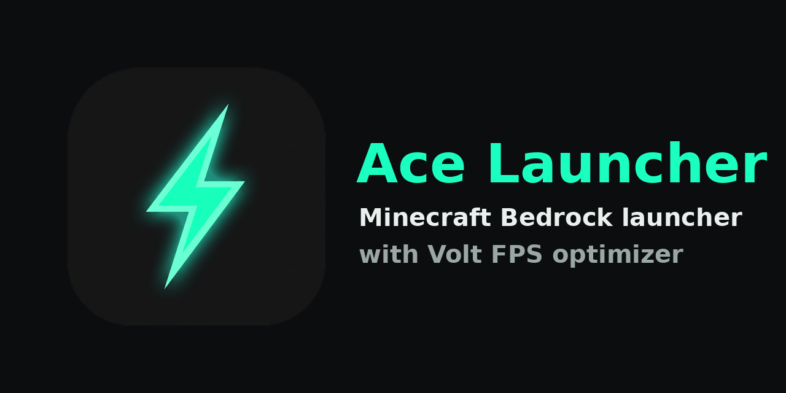

# Ace Launcher

**A Minecraft: Bedrock Edition launcher for Android, with mod support and a built-in FPS optimizer for low-end devices.**

Ace Launcher lets you run your own licensed copy of Minecraft Bedrock, manage multiple game versions, and load native `.levipack` mods. It ships with **Volt**, an FPS optimizer made to help weak phones run the game smoother and cooler, and installs it for you automatically.

## Features

- **Volt auto-install:** Volt is bundled inside the launcher and installs itself for Minecraft 1.26.52. No manual import needed.
- **Mod loading:** import `.levipack` native modules, switch them on or off, and reorder them.
- **Volt FPS optimizer (v2.3.2):**
  - Frame cap: 0 for unlimited, or 60, 90 or 120 to reduce heat and tearing
  - Chunk level of detail
  - Culling of chunks behind you and of distant entities
  - Paced chunk rebuilds to avoid stutter
  - Frame-spike detection
- **Multiple game versions:** keep several Minecraft versions, each with its own settings and data.
- **Worlds and resource packs:** import, export and back up.
- **Accounts:** manage more than one Xbox account.
- **Ace look:** dark neon-mint theme and a lightning-bolt icon.

## Requirements

- Android 9.0 or newer
- An ARM64 (arm64-v8a) phone
- 2 GB or more of RAM recommended, and about 2 GB of free storage
- A licensed copy of Minecraft Bedrock from Google Play. Volt targets Bedrock **1.26.52**.

## Install

1. Download the latest APK from **Releases**, or from **Actions → Artifacts** for the newest test build.
2. Allow "Install unknown apps" for your browser or file manager, then install the APK.
3. Open Ace Launcher and import your Minecraft APK. You need to own the game.

## Using Volt

Volt installs automatically for Minecraft **1.26.52**:

1. Create or select a 1.26.52 game version.
2. Launch it. Volt is installed into that version's mods and switched on.
3. Adjust Volt's options in the in-game mod menu.

How the auto-install behaves:

- It installs once per version. If you delete or disable Volt, the launcher won't reinstall or re-enable it.
- An existing Volt is left alone and never downgraded.
- Other Minecraft versions are skipped.

**Manual install (fallback):** open **Mods → Import** and choose `bundled-mods/Ace-Volt-2.3.2.levipack`.

## Building

The project builds with GitHub Actions (`.github/workflows/build.yml`). To build locally you need JDK 21, the Android SDK, NDK r28c and xmake. The native sources (`preloader`, `libHttpClient`, `zstd`) must be present before running `./gradlew assembleDebug`.

## Credits and legal

- Based on [LeviLaunchroid](https://github.com/LiteLDev/LeviLaunchroid) by LiteLDev, under the Apache-2.0 license. The original license is kept.
- Volt is by DrukisMC.
- Ace Launcher is **unofficial** and not affiliated with Mojang or Microsoft. Minecraft is a trademark of Mojang. You must own a legitimate copy of the game. Do not use this with pirated copies. Mods are used at your own risk.
